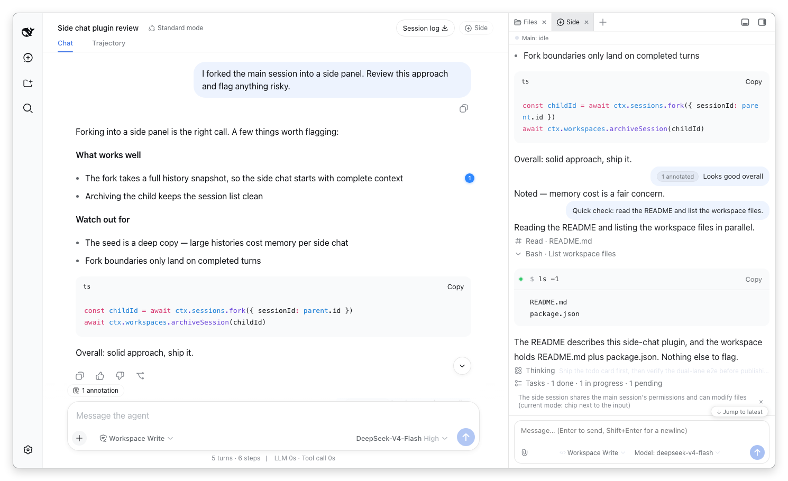

# dsh-sidechat

English · [中文](README.md)

A DSH plugin for independent side chats, selection annotations and sending conclusions back to the main conversation.

## Install

```bash
dsh plugin --profile web add github:kkisok0123/dsh-sidechat
```

This repository includes source and prebuilt `lib/` files. GitHub installation requires no compilation on the user's machine. Restart `dsh web` and refresh the window after installation.

If `dsh-sidenote` is already installed, remove it before installing this plugin to avoid duplicate entries:

```bash
dsh plugin --profile web remove dsh-sidenote
```

Open a conversation with an existing reply. Click **Side** in its header, or enter `/side` in the composer, to open the plugin in the right sidebar.

## Features

- An independent side conversation forks the main conversation's complete history.
- Side-conversation semantics match Codex `/side`: the first message carries a boundary protocol block (inherited history is reference-only; the side chat is a separate assistant that does not mutate by default, avoids sub-agents, and does not request escalated permissions), rendered as a "side conversation boundary" card.
- On DSH 0.2.0-rc.2, the plugin uses the host's native Conversation Factory for messages, tools, models, permissions and composer. Older hosts use the plugin renderer.
- The model menu refreshes provider labels and restores composer focus after a model change.
- Select assistant text: **Add to conversation** keeps the optional annotation editor; **Ask in side chat** directly opens/focuses the side chat, adds a selected-text reference and focuses its composer. It does not open a note editor, replace the draft or send automatically. Failed openings retain the selection for retry or cancellation.
- Temporary side conversations are hidden from the current browser's session list and can be reopened. Saving creates a separate visible session.
- Bring side-chat conclusions back as references in the main composer.

This image illustrates the right-sidebar layout. Message and composer appearance vary with host version, theme and native rendering mode. It is separate from the host's floating side-conversation window.



## Compatibility

The package retains the upstream engine declarations and requires Node.js 20 or later. Native conversation rendering targets DSH **0.2.0-rc.2**. The engine range does not mean that every combination has been verified.

## Development

```bash
pnpm install --frozen-lockfile
pnpm check:arch
pnpm typecheck
pnpm build
pnpm check:package
```

Commit the corresponding `lib/` files whenever source changes. CI rebuilds and checks that generated files match the committed version so direct GitHub installation remains usable.

## Origin and license

This plugin is an improved derivative of [gyixuan's dsh-sidenote](https://github.com/g-yixuan/dsh-sidenote). Thank you to the original author for the side-chat, selection-annotation and handback foundations. This project is not an original implementation from scratch or an official upstream release.

This branch adds native host conversation rendering, explicit side-conversation boundaries, direct selection-to-side-chat questions, model-switch focus restoration, and DSH 0.2.1-alpha.4 compatibility. See the features and limitations above.

The original `Copyright (c) 2026 gyixuan` and full [MIT license](LICENSE) are preserved. This repository starts from an independent source snapshot without upstream Git history; its maintainer is responsible for subsequent changes.
